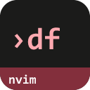
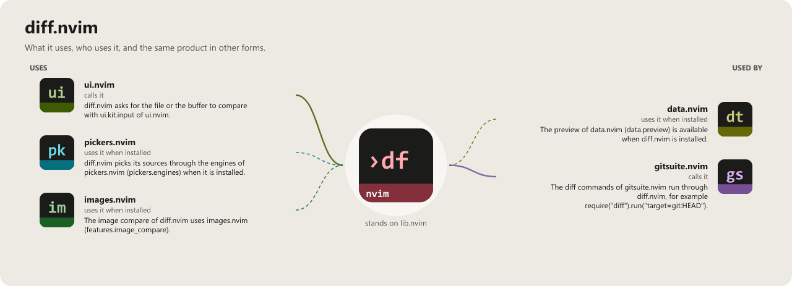

> **Beta stage — active development.** This repository is past its first shape and in
> active use, but the surface is not frozen: breaking changes are still possible. Pin a
> commit or tag if you depend on it.

# diff.nvim

```
██████╗ ██╗███████╗███████╗
██╔══██╗██║██╔════╝██╔════╝
██║  ██║██║█████╗  █████╗
██║  ██║██║██╔══╝  ██╔══╝
██████╔╝██║██║     ██║
╚═════╝ ╚═╝╚═╝     ╚═╝
                  .nvim
```

[](LICENSE)
[](https://neovim.io)
[](https://www.lua.org)

[](https://wkdsteve.github.io/wkd/p/diff/)

> Part of the [wkd](https://wkdsteve.github.io/wkd/) family — see this plugin's [page](https://wkdsteve.github.io/wkd/p/diff/) on the site.

Flexible diffing for Neovim: one `:Diff` command compares arbitrary sources —
buffers, files, git revisions, URLs, whole directories — against each other and
delivers the result however you like: split, inline, prompt, file, clipboard, or
a one-line stat summary.

---

## Documentation

Start at [docs/README.md](docs/README.md) — what's where, and which question
each page answers.

### Getting it running

- [Requirements](docs/installation.md#requirements) — Neovim version, required plugins and CLI tools.
- [Installation](docs/installation.md) — plugin managers and load-trigger variants.
- [Quickstart](docs/quickstart.md) — the first thing to run after installing.
- [Configuration](docs/configuration.md) — every `setup()` option and its default.
- [Testing and health check](docs/testing.md) — what `:checkhealth diff` reports, and how to run the spec suite.

### Using it

- [Commands](docs/commands.md) — the full `:Diff` argument grammar, examples, and tab completion.
- [Workflow](docs/WORKFLOW.md) — which shape of `:Diff` answers which everyday question.
- [Three-way diff](docs/three-way-diff.md) — `base=` for merge-conflict workflows, layout, examples.
- [URL sources](docs/url-sources.md) — diffing against `http(s)://` URLs: async fetch, timeout, examples.
- [Lua API](docs/api.md) — the `require("diff")` module surface.
- [Bindings cheatsheet](docs/BINDINGS.md) — every keymap, user command and autocommand.

### The rest

- [Features](docs/FEATURES.md) — everything diff.nvim does, one section per capability.
- [Around it](docs/around-it.md) — pickers.nvim and images.nvim, and what changes when they're installed.
- [Architecture](docs/architecture.md) — module layout and load order.
- [Contributing](docs/CONTRIBUTING.md) — ground rules, project layout, and how to add a source.
- [Feedback](https://github.com/WKDSteve/diff.nvim/issues) — bugs, features, questions; broader discussion in [Discussions](https://github.com/WKDSteve/diff.nvim/discussions).

`:help diff.nvim` is the same reference inside the editor.

---

## License

MIT — see [LICENSE](LICENSE).

<!-- connections:begin (written by the app-icons tool of the workshop; change integrations.json there, not this block) -->
## Connections



**Uses**

- [images.nvim](https://github.com/WKDSteve/images.nvim): The image compare of diff.nvim uses images.nvim (`features.image_compare`). ([picture](assets/graphs/pair/diff.nvim--images.nvim.png))
- [pickers.nvim](https://github.com/WKDSteve/pickers.nvim): diff.nvim picks its sources through the engines of pickers.nvim (`pickers.engines`) when it is installed. ([picture](assets/graphs/pair/diff.nvim--pickers.nvim.png))
- [ui.nvim](https://github.com/WKDSteve/ui.nvim): diff.nvim asks for the file or the buffer to compare with `ui.kit.input` of ui.nvim. ([picture](assets/graphs/pair/diff.nvim--ui.nvim.png))
- [lib.nvim](https://github.com/WKDSteve/lib.nvim): the shared base of the plugins.

**Used by**

- [data.nvim](https://github.com/WKDSteve/data.nvim): The preview of data.nvim (`data.preview`) is available when diff.nvim is installed. ([picture](assets/graphs/pair/data.nvim--diff.nvim.png))
- [gitsuite.nvim](https://github.com/WKDSteve/gitsuite.nvim): The diff commands of gitsuite.nvim run through diff.nvim, for example `require("diff").run("target=git:HEAD")`. ([picture](assets/graphs/pair/gitsuite.nvim--diff.nvim.png))
<!-- connections:end -->
